<div align="center">

# GeoBasin Explorer AI

### Ask a sedimentary basin a question. Get a cited answer on a map.

A multimodal AI assistant for oil, gas and energy-transition teams, built on Microsoft Azure and Microsoft Fabric.

[](AUTHORS.md)
[](LICENSE)
[](https://github.com/kimvaddi/geobasinexplorer/actions/workflows/ci.yml)


[See it in action](#see-it-in-action) · [Why it exists](#why-it-exists) · [Features](#features) · [Screenshots](#screenshots) · [Architecture](#architecture) · [Get started](#get-started) · [Documentation](#documentation)

<br>

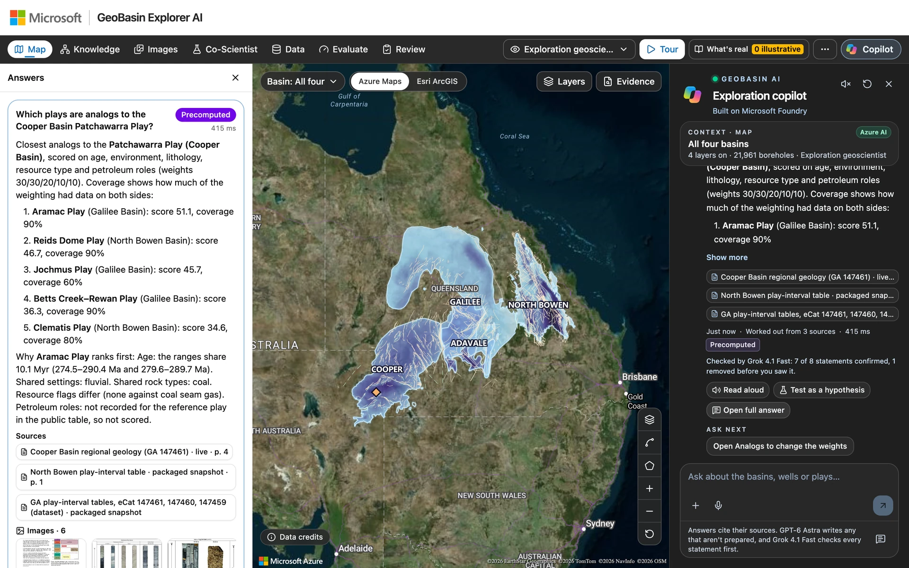

<sub>Every answer cites its sources and is checked by a separate validator model before you see it.</sub>

</div>

## See it in action

<table>
<tr>
<td width="50%" valign="top">

https://github.com/user-attachments/assets/6307d614-a488-4707-baec-028fb49a66d2

<b>A 30-second tour.</b> Pick a role, click the map, ask two questions, then open the knowledge graph, the Co-Scientist and image search.
</td>
<td width="50%" valign="top">

https://github.com/user-attachments/assets/b3ea6a45-6aa6-414a-8ef6-1ef486010dc7

<b>Ask, verify and see the work.</b> One answer comes from a prepared rule and one is written by a Microsoft Foundry agent. Both are checked statement by statement, and every step is shown.
</td>
</tr>
<tr>
<td valign="top">

https://github.com/user-attachments/assets/32fc1b20-5cf9-4ebe-9f29-826d875b63a6

<b>Fabric IQ, ontology and graph.</b> The ontology agent and a GQL query on the graph model return the same five deepest wells in the Galilee Basin.
</td>
<td valign="top">

https://github.com/user-attachments/assets/97233bb6-9d5f-42d5-9f87-5e8e8cdac7f7

<b>The ingestion framework.</b> One pipeline run copies the datasets, then builds the tables, the ontology and the graph in about 14 minutes.
</td>
</tr>
</table>

<sub>The videos play right here, and each one can be opened full screen. They were recorded live on a Microsoft-hosted deployment that runs only on public data. Long agent waits are shortened, and the video labels each one. The MP4 files are also in <a href="docs/media">docs/media</a>.</sub>

## Why it exists

Every exploration, carbon-storage or geothermal decision starts with the same question: **what do we already know about this basin?**

The answer is usually spread across decades of public records:

- **Scanned well reports**, some from the 1960s, with handwritten notes and mixed units.
- **Regional geology packages** delivered as shapefiles, grids and PDF reports.
- **Temperature, stress and geophysical surveys**, each in its own catalog, datum and license.

Teams can spend weeks finding, reading and reconciling this material before any interpretation starts. The energy transition adds new questions about CO₂ storage, geothermal heat, hydrogen and critical minerals. These questions must be answered from the same old data, often by people who did not create it. Any AI used for this work must show its evidence.

GeoBasin Explorer AI shows how multimodal AI on Azure and Microsoft Fabric close this gap. It reads documents and images, keeps every value linked to its source, builds a shared knowledge model, and answers only what the evidence supports. When the evidence is missing, it says **Not found**.

## Features

<table>
<tr>
<td width="50%" valign="top"><b>Cited answers</b><br>Ask in plain language. Every statement cites a page, figure or dataset row, and a validator model from a different model family checks each one.</td>
<td width="50%" valign="top"><b>Map-first workspace</b><br>Basins, wells, faults and surveys on Azure Maps. Click any point to see what is known there, or draw an area or a cross-section.</td>
</tr>
<tr>
<td valign="top"><b>Knowledge graph and ontology</b><br>Formations, plays, wells and documents as connected knowledge in Microsoft Fabric. Agents query it through Fabric IQ with each user's own permissions.</td>
<td valign="top"><b>Co-Scientist</b><br>A team of AI agents tests your hypothesis and reports the evidence for, against and missing. A critic challenges the draft. You record the verdict.</td>
</tr>
<tr>
<td valign="top"><b>Multimodal evidence</b><br>Scanned reports, tables, figures and core photos are read with Azure Document Intelligence and made searchable by meaning and place with Azure AI Search.</td>
<td valign="top"><b>Low-carbon lens</b><br>Screen CO₂ storage and geothermal potential on legacy wells against published criteria, and see where the evidence is thin.</td>
</tr>
<tr>
<td valign="top"><b>Governed data</b><br>Every source keeps its publisher, license and lineage. Experts approve each extraction before it is published.</td>
<td valign="top"><b>Repeatable deployment</b><br>Bicep or Terraform, greenfield or brownfield, in your own Azure subscription and Microsoft Entra tenant.</td>
</tr>
</table>

## Screenshots

<table>
<tr>
<td width="50%" valign="top">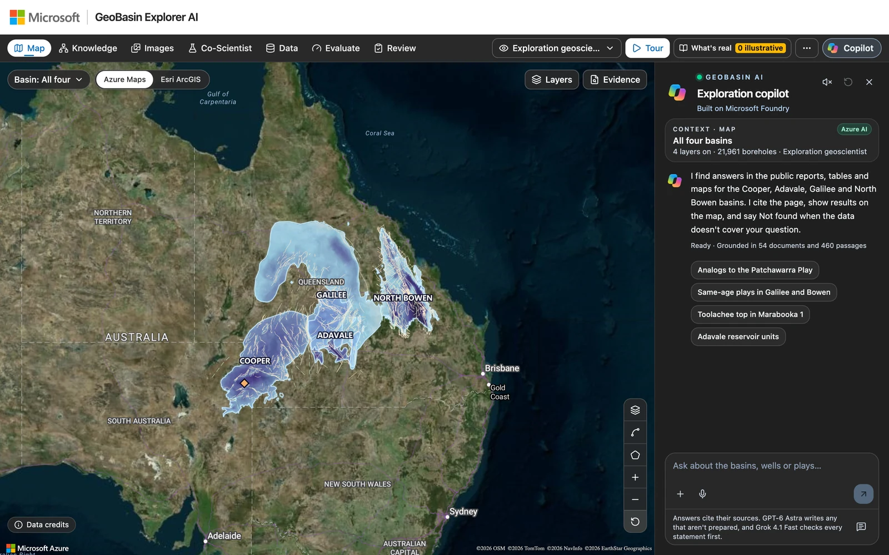<br><b>Map workspace.</b> Four basins on Azure Maps, with the copilot beside the map.</td>
<td width="50%" valign="top">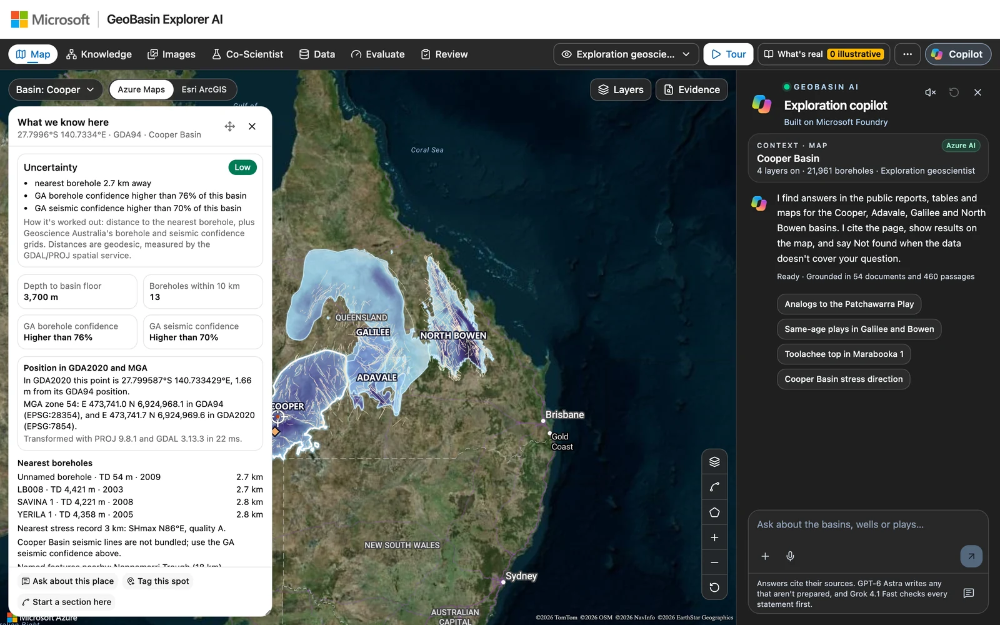<br><b>What we know here.</b> Depth, uncertainty and nearby boreholes for any point, measured by the GDAL/PROJ service.</td>
</tr>
<tr>
<td valign="top">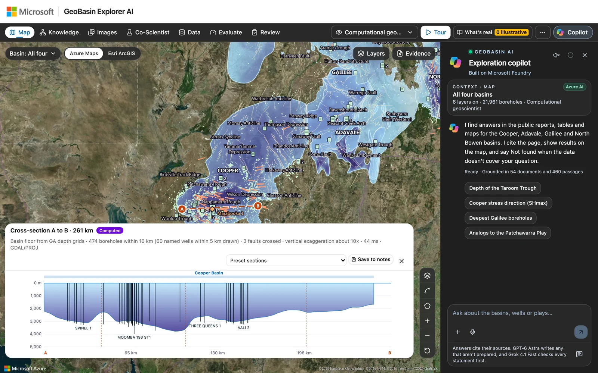<br><b>Cross-sections.</b> A computed section across the Cooper Basin, with boreholes and faults along the line.</td>
<td valign="top">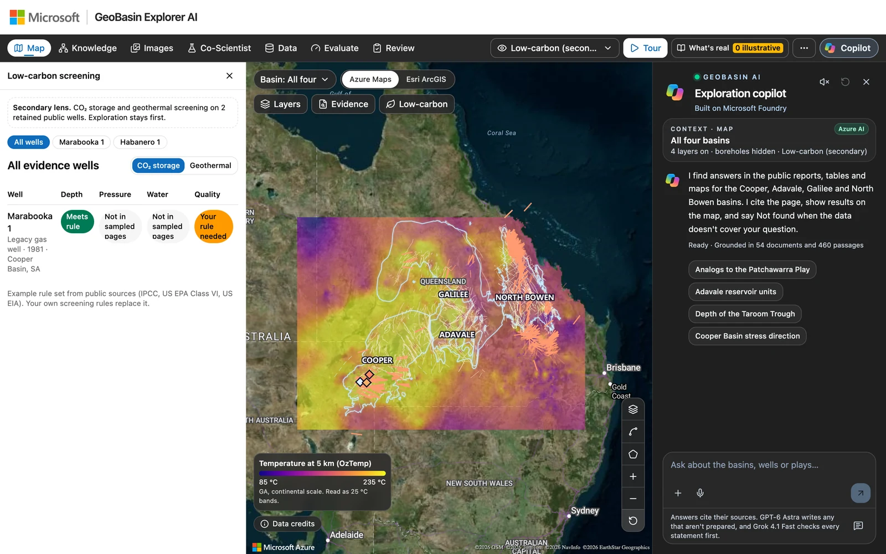<br><b>Low-carbon lens.</b> CO₂ storage and geothermal screening, with temperature at 5 km.</td>
</tr>
<tr>
<td valign="top">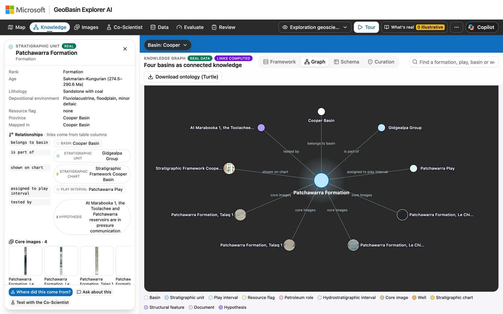<br><b>Knowledge graph.</b> A formation with its basin, group, play, core images and the hypothesis that tests it.</td>
<td valign="top">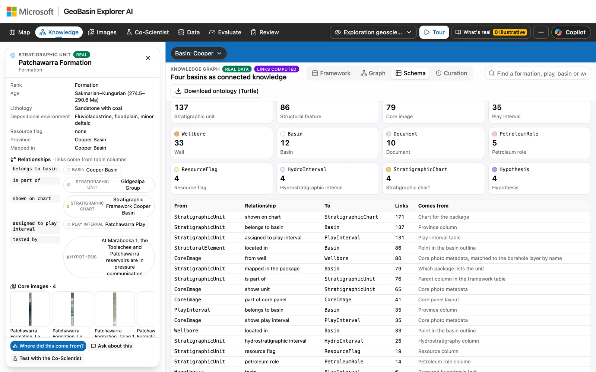<br><b>Ontology.</b> Entity types, relationship types and where each link comes from.</td>
</tr>
<tr>
<td valign="top">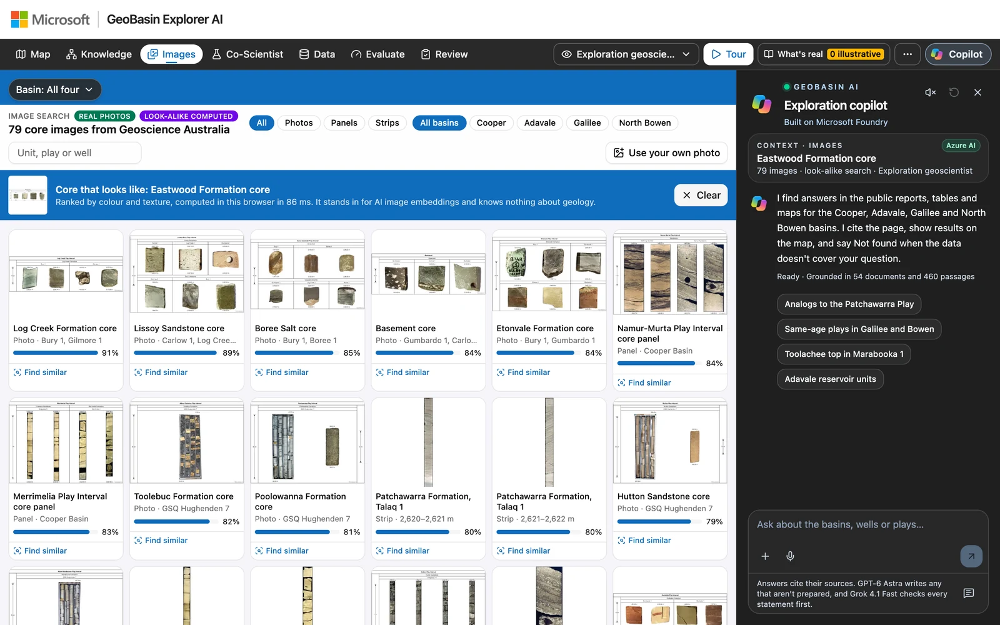<br><b>Image search.</b> Core photos ranked by look-alike similarity, each linked to its unit and well.</td>
<td valign="top">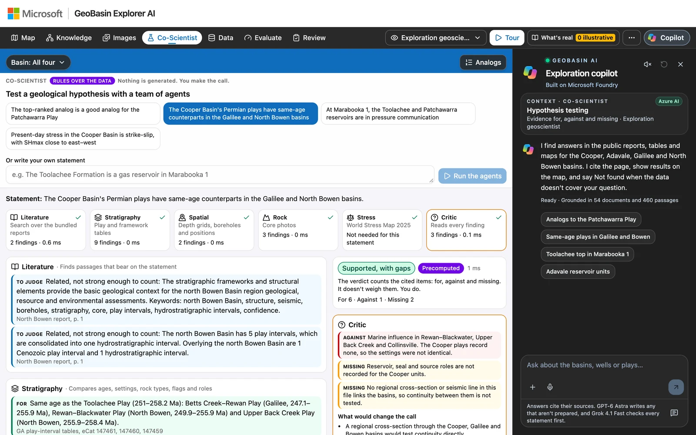<br><b>Co-Scientist.</b> Specialist agents report evidence for, against and missing, and a critic challenges the draft.</td>
</tr>
<tr>
<td valign="top">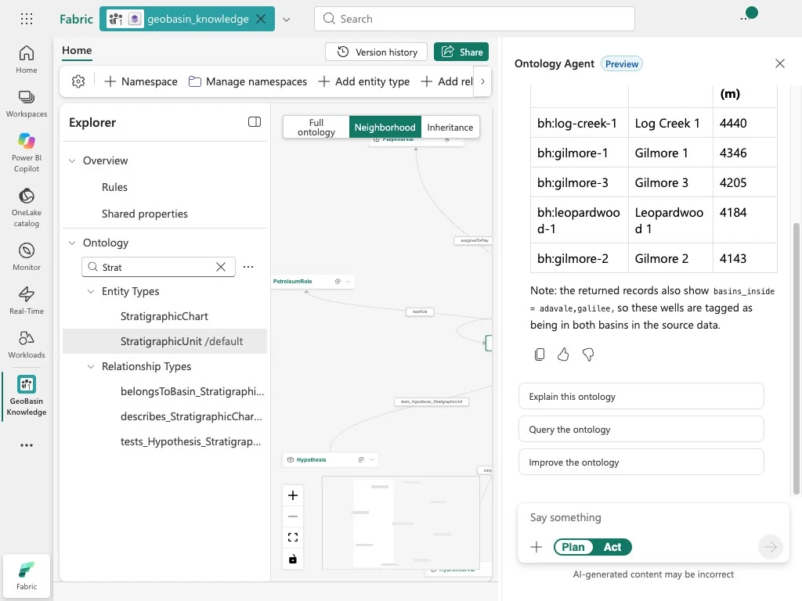<br><b>Fabric IQ.</b> The ontology agent in Microsoft Fabric answers a plain-language question from the data bound to the ontology.</td>
<td valign="top">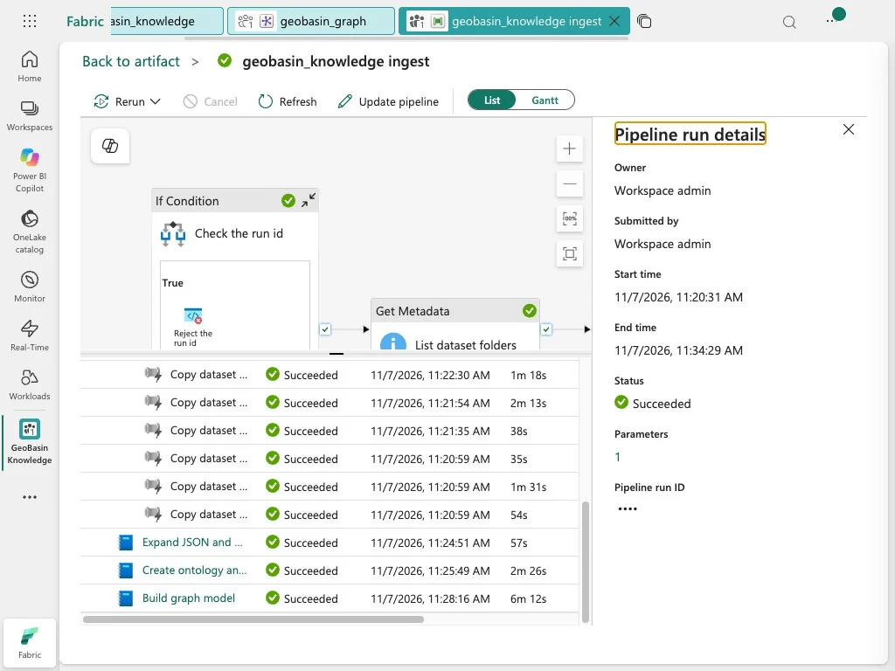<br><b>Ingestion run.</b> Every dataset copy and notebook of one successful pipeline run, with its duration.</td>
</tr>
</table>

<p align="center"><a href="docs/SCREENSHOTS.md"><b>Take the full product tour →</b></a></p>

<sub>Screenshots come from a Microsoft-hosted deployment that runs only on public data.</sub>

## Architecture

<a href="docs/architecture/technical-architecture.png">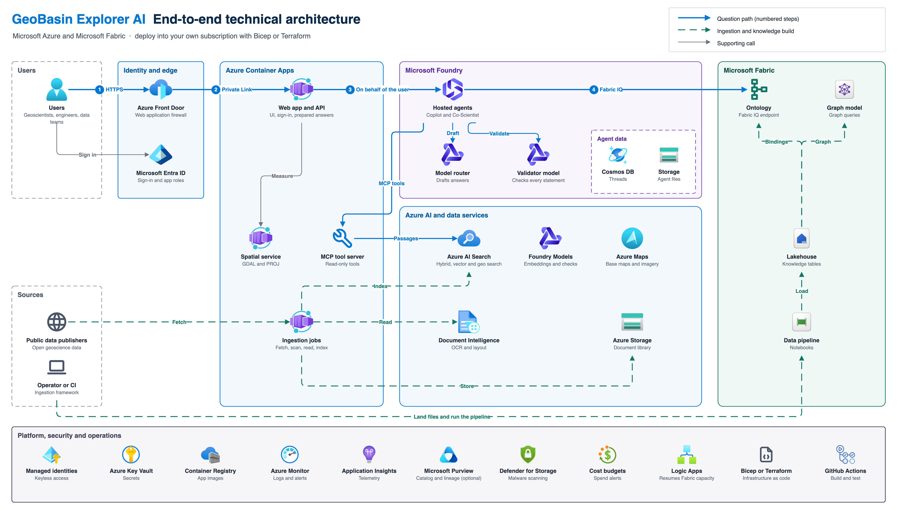</a>

A question follows four numbered steps:

1. The user connects over HTTPS to **Azure Front Door**, which applies a web application firewall. Microsoft Entra ID signs the user in.
2. Front Door reaches the **web app and API** in Azure Container Apps over **Private Link**.
3. The API starts the **hosted agents** in Microsoft Foundry on behalf of the user. Specialist agents gather evidence through a read-only **MCP tool server**. The model router drafts the answer and a separate **validator model** checks every statement.
4. The agents query the **ontology in Microsoft Fabric** through Fabric IQ with the user's own permissions.

Ingestion runs separately. Jobs fetch public sources, scan them, read them with Document Intelligence and index them in Azure AI Search after an expert approves them. The ingestion framework builds the lakehouse, ontology and graph model in Fabric.

[Architecture guide](docs/ARCHITECTURE.md) · [Editable diagram (draw.io)](docs/architecture/technical-architecture.drawio) · [Interactive viewer (HTML)](docs/architecture/technical-architecture.html)

### Azure services

| Service | Role |
|---|---|
| Microsoft Foundry Agent Service | Hosts the Copilot and Co-Scientist agents. Agent state stays in your own Cosmos DB, Storage and AI Search. |
| Foundry model router and validator model | Routes drafting to an approved set of models. A model from a different family checks every statement. |
| Azure Document Intelligence | Reads scanned and digital reports, tables and layout. |
| Azure AI Search | Hybrid, vector and geo search over passages, pages and figures. |
| Microsoft Fabric and Fabric IQ | Lakehouse, ontology and graph model: the knowledge model that people and agents share. |
| Azure Container Apps | Web app and API, MCP tool server, spatial service, ingestion jobs and malware scanner. |
| Azure Front Door Premium | The only public entry, with a web application firewall and Private Link. |
| Microsoft Entra ID and managed identities | Sign-in, app roles and keyless access to every service. |
| Azure Storage, Key Vault and Defender for Storage | Private document library, secrets and malware scanning. |
| Azure Maps | Base maps and imagery for the map workspace. |
| Azure Monitor and Application Insights | Telemetry, agent traces, alerts and budgets. |
| Microsoft Purview (optional) | Data catalog and lineage. |

## Who it is for

| Audience | What they get |
|---|---|
| Exploration and production geoscientists, petrophysicists, reservoir engineers | Faster basin screening, with an evidence trail they can defend |
| CO₂ storage, geothermal and new-energy teams | New value from legacy well data |
| Research leads and program managers | Structured hypothesis testing, with decisions on record |
| Subsurface data managers and data scientists | A repeatable path from raw public data to an ontology, a graph and a search index |
| Cloud architects, platform and security engineers | A secured, multi-agent AI reference implementation in Bicep and Terraform |
| Microsoft and partner field teams | A working demonstration that deploys into a customer's own tenant |

[Business context](docs/BUSINESS_CONTEXT.md) explains the industry problem, the business drivers and the use cases in more detail.

## Get started

**Try it offline.** No Azure resources are needed. The build folds the interface and its bundled public data into one HTML file that makes no network calls.

```bash
cd app
npm ci
npm run build          # writes dist/geobasin-explorer-ai.html; open it in a browser
```

**Deploy to Azure.** Copy a settings template, fill it in, and run the deployment phases.

```bash
cp infra/config/environment.example.env infra/config/environment.env   # or live-equivalent.example.env, then edit it
az login
infra/scripts/deploy.sh all         # foundation to edge, then lists the steps that need a person
infra/scripts/deploy.sh knowledge   # after opening the new graph model once in the Fabric portal
infra/scripts/deploy.sh content     # after the edge cut-over: indexes, then every public source for expert review
infra/scripts/deploy.sh library     # the library in OneLake; rerun after each approval to publish from gold
infra/scripts/deploy.sh smoke       # checks the deployment
```

A few steps need a person, and `all` lists them when it finishes: delegating your DNS zone and approving Front Door's Private Link connection, opening the new graph model once in the Fabric portal, landing three sources whose publishers serve them only to a browser, and approving each extraction before it is published. [`live-equivalent.example.env`](infra/config/live-equivalent.example.env) reproduces the reference deployment, including the map's Planetary Computer overlays and Microsoft Purview.

| Scenario | How |
|---|---|
| Greenfield (empty subscription) | Every phase creates what it needs, including the Fabric capacity and workspace. |
| Brownfield (existing landing zone) | Reuse an existing Fabric capacity, workspace or DNS zone, and place the agents in a second subscription if needed. |
| Terraform | Apply [infra/terraform](infra/terraform) in passes, then use the same scripts for the Entra, Fabric and agent steps. |

The [deployment guide](docs/DEPLOYMENT.md) covers prerequisites, quotas, each phase and the one step that needs a person in the Fabric portal.

## Repository layout

| Folder | Contents |
|---|---|
| [app/](app) | React web app. It also builds as a single offline HTML file. |
| [services/api/](services/api) | Node.js API: answers, uploads, reviews, the live ingestion lane and the MCP tool server. |
| [services/scientists/](services/scientists) | Python Microsoft Agent Framework workflow behind the hosted agents, and its deployment script. |
| [services/spatial/](services/spatial) | GDAL/PROJ spatial service for sections, distances and areas. |
| [services/scanner/](services/scanner) | ClamAV malware scanner for the live ingestion lane. |
| [ingestion-framework/](ingestion-framework) | Reusable ontology ingestion framework for Microsoft Fabric. |
| [infra/](infra) | Bicep templates, Terraform configuration and deployment scripts. |
| [data/sources/](data/sources) | Public source manifest: publisher, license and link for each source. |
| [pipeline/](pipeline) | Checks downloaded source files against the manifest. |
| [docs/](docs) | Guides, architecture diagram, screenshots and videos. |
| [tests/](tests) | End-to-end and answer tests. |
| [tools/](tools) | Repository checks, such as the public data check that runs in CI. |

## Documentation

| Guide | Read it to learn about |
|---|---|
| [Business context](docs/BUSINESS_CONTEXT.md) | The problem, drivers, audiences, use cases and measures of success |
| [Product tour](docs/SCREENSHOTS.md) | Every screen of the app and its knowledge layer in Microsoft Fabric, plus the videos |
| [Architecture](docs/ARCHITECTURE.md) | Components, flows, design principles and fallbacks |
| [Deployment](docs/DEPLOYMENT.md) | Greenfield and brownfield deployment with Bicep or Terraform |
| [Scientist agents](docs/FOUNDRY_AGENTS.md) | The agent workflow, tools, identity and the model router |
| [Fabric knowledge build](docs/FABRIC_KNOWLEDGE.md) | The lakehouse, ontology and graph model |
| [Library in OneLake](docs/LIBRARY_ONELAKE.md) | Shortcuts to the closed storage account, silver and gold Delta tables, and publishing from gold |
| [Security and responsible AI](docs/SECURITY.md) | Controls, decisions for each deployment and preview features |
| [Data sources](docs/DATA_SOURCES.md) | Every public source and its license |
| [Ingestion framework](ingestion-framework/README.md) | Building an ontology and graph from your own datasets |
| [Infrastructure](infra/README.md) | Templates, scripts and conventions |

## Data and license

- **Code and documentation** are released under the [Apache License 2.0](LICENSE). Anyone who redistributes them, changed or unchanged, must keep the attribution notices in [NOTICE](NOTICE).
- **Data** keeps the license its publisher chose. All data comes from public sources, including Geoscience Australia, the Department for Energy and Mining of South Australia, Toitū Te Whenua Land Information New Zealand, New Zealand Petroleum and Minerals, the Intergovernmental Committee on Surveying and Mapping, the World Stress Map and Natural Earth.
- **A license gate** in the build withholds any source whose reuse terms are not confirmed, so the bundled data and the answers carry only content that may be redistributed.

[Data sources](docs/DATA_SOURCES.md) cites every source and its license. [NOTICE](NOTICE) carries the required attributions.

## Security and responsible AI

- **No keys.** Every caller signs in with Microsoft Entra ID. Each workload uses its own managed identity with least-privilege roles.
- **Private by default.** Storage, Key Vault and the Container Apps environment are private. Front Door with a web application firewall is the only way in.
- **Scanned before read.** Uploads and fetched files are scanned for malware before anything reads them.
- **Read-only agent tools.** Agents reach data only through a read-only tool server that checks a short-lived, signed run ticket and applies each user's limits and access.
- **Grounded answers.** Every statement must cite its evidence. Unsupported statements are removed and shown as removed. When the evidence is silent, the answer is "Not found".
- **People decide.** Experts approve extractions before publication, and only a person records a Co-Scientist verdict.

Answers support professional judgment. They do not replace it. [Security and responsible AI](docs/SECURITY.md) describes every control.

## Credits

GeoBasin Explorer AI began with a vision from **Jorge Peña Alarcón** (Microsoft) to bring a basin's scattered public record into one place, where people could ask questions in plain language and receive answers supported by evidence. Jorge's low-code prototype demonstrated the art of the possible.

That vision became reality when **Kim Vaddi** (Microsoft) partnered with Jorge to take it from low code to pro code. Kim architected the Azure platform and engineered the solution for governance, security and repeatable deployment, while preserving the intent of the original prototype.

Today, GeoBasin Explorer AI pairs hosted AI agents in Microsoft Foundry with an independent validator that checks every statement. A governed knowledge model in Microsoft Fabric gives people and agents a shared understanding of the basin through Fabric IQ. Azure Document Intelligence and Azure AI Search supply the multimodal evidence behind each answer. Identity, network, security and cost controls let organizations run it inside their own tenant, while Bicep and Terraform templates make every deployment repeatable, whether greenfield or brownfield.

The result is a fully tested, deployable solution that shows what low-code vision and pro-code engineering can achieve together.

GeoBasin Explorer AI is built and maintained by **Kim Vaddi**. If you use, fork or redistribute it, keep the credit in [AUTHORS.md](AUTHORS.md) and the attribution notices in [NOTICE](NOTICE), as the [Apache License 2.0](LICENSE) requires, and cite it with [CITATION.cff](CITATION.cff).
