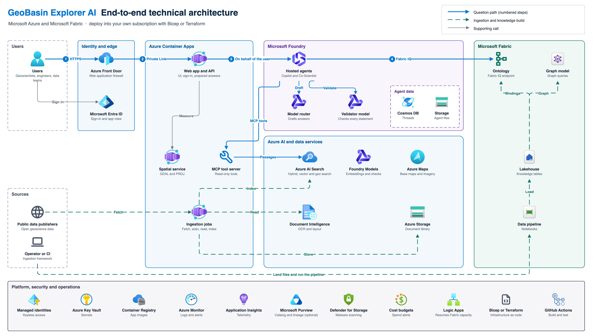

# Architecture

GeoBasin Explorer AI has five parts:

- a secured **web app and API**;
- **AI agents** hosted in Microsoft Foundry;
- an **evidence index** in Azure AI Search;
- a governed **knowledge model** in Microsoft Fabric;
- **ingestion pipelines** that keep the index and the knowledge model current.

This guide explains how the parts fit together and why.

<a href="architecture/technical-architecture.png"></a>

The diagram's editable source is [technical-architecture.drawio](architecture/technical-architecture.drawio). Open it in diagrams.net or the Draw.io extension for Visual Studio Code. [technical-architecture.html](architecture/technical-architecture.html) is an interactive viewer for a browser.

## Components

| Layer | Components | Purpose |
|---|---|---|
| Edge and identity | Azure Front Door Premium with a web application firewall, Microsoft Entra ID | Single public entry point, sign-in and app roles |
| Application | Web app and API, MCP tool server, spatial service (GDAL and PROJ), in Azure Container Apps | User interface, answer flow, read-only agent tools, exact spatial math |
| Agents | Hosted agents, model router and validator model in Microsoft Foundry, with agent data in Cosmos DB and Storage | Multi-agent reasoning with an independent check of every statement |
| Evidence | Azure AI Search, Azure Document Intelligence, Foundry Models for embeddings, Azure Storage, Azure Maps | Read, store, index and map the evidence |
| Knowledge | Lakehouse, ontology, graph model and data pipeline in Microsoft Fabric | The knowledge model that people and agents share |
| Ingestion | Ingestion jobs in Azure Container Apps and the ingestion framework | Bring public data in, scan it, read it and publish it |
| Platform | Managed identities, Key Vault, Container Registry, Azure Monitor, Application Insights, Defender for Storage, budgets, Logic Apps, Microsoft Purview (optional) | Security, operations, cost control and governance |

## Design principles

| Principle | What it means |
|---|---|
| One copy of each dataset | Curated data is stored once, with its source and license. Everything else is derived from it. |
| One knowledge model | The ontology built by the ingestion framework is shared by the app, the agents and analysts. |
| A fixed answer contract | Every statement cites a passage, page or dataset row, or the answer says "Not found". A validator checks every statement against the evidence that was actually retrieved. |
| Tools read the data, not agents | Agents reach data only through a read-only tool server that applies allowlists, limits, license filters and each user's access. Agents never call Search, Storage or Fabric directly. |
| Gates fail closed | The checksum, the malware scan, expert approval and the publication step each stop the flow when they cannot confirm their condition. |
| Degrade, never fail | When Fabric is paused or slow, the app answers from search and its bundled snapshot, and says so. |
| Preview features behind one interface | The ontology, graph, graph query API and Fabric IQ sit behind one module that can change without touching the screens. |
| Agent state stays in your subscription | Conversations, agent definitions, files and vector stores live in your own Cosmos DB, Storage and AI Search, through Foundry's standard agent setup. |

## Layers in detail

**Edge.** Azure Front Door Premium is the only public entry. Its web application firewall applies Microsoft's default and bot rule sets and per-client rate limits. Front Door connects to the Container Apps environment only over Private Link, and the environment's public network access is off. The Container Apps sign-in layer checks every request against a single-tenant Entra app registration that requires role assignment.

**Interface.** The React app has a map workspace (Azure Maps, with optional Esri base maps and Planetary Computer overlays relayed through the API), a knowledge view, an images view, the Co-Scientist, a data workspace, evaluation and expert review. The copilot sits beside each view.

**API.** A Node.js service in the same container as the interface. It:

- books each question against daily and per-user limits;
- issues a signed run ticket, starts the agents, polls them and returns the validated answer;
- accepts uploads into quarantine and runs expert review and feedback;
- serves knowledge cards and relays map tiles with the app's own identity;
- hosts the MCP tool server that the agents call.

**Spatial service.** A separate GDAL/PROJ service measures sections, distances and areas, so spatial answers never depend on a language model's arithmetic.

**Agents.** One Microsoft Agent Framework workflow in Python, hosted in Microsoft Foundry as two agents: `gbx-copilot` answers questions and `gbx-coscientist` tests hypotheses. A lead agent routes work to specialists (literature, stratigraphy, spatial, rock and stress). A critic challenges the draft, and a validator checks every statement. Drafting uses the Foundry model router with an approved set of models. The validator runs on a fixed deployment from a different model family, so no model checks its own writing. See [FOUNDRY_AGENTS.md](FOUNDRY_AGENTS.md).

**Knowledge.** Two stores work together:

- **Azure AI Search** indexes every passage, page and figure with embeddings, geotags and license. It answers hybrid queries by meaning and by place.
- **Microsoft Fabric** holds typed entity and relationship tables in a lakehouse, an ontology bound to them, and a graph model over the same tables.

Agents query the ontology through Fabric IQ as the signed-in user. When Fabric IQ cannot answer, typed graph tools on the tool server take over. See [FABRIC_KNOWLEDGE.md](FABRIC_KNOWLEDGE.md).

**Ingestion.** Three paths bring data in:

1. **Live lane.** Fetches registered public sources, verifies each file's checksum, holds it in quarantine until the ClamAV scanner clears it, reads it with Document Intelligence, and publishes it after an expert approves it.
2. **Uploads.** Files from signed-in users pass the same gates. Microsoft Defender for Storage scans each file first.
3. **Ingestion framework.** Turns curated datasets into the Fabric knowledge model, from the command line or as a Data Factory pipeline in Fabric.

**Platform.** Every service authenticates with Microsoft Entra ID. Keys and local authentication are disabled. Each workload has its own user-assigned managed identity with only the roles it needs. Storage and Key Vault sit behind private endpoints. The agents' Cosmos DB and Storage sit behind a network security perimeter. See [SECURITY.md](SECURITY.md).

**Operations.** Application Insights and Log Analytics collect telemetry from the app, the jobs and the hosted agents, including a trace of each agent run. Alerts watch for error spikes and logging limits. Budgets warn before spend exceeds plan. A kill switch turns off every model call at once. An optional Logic App resumes the Fabric capacity each morning, and Microsoft Purview can catalog the workspace and record lineage.

## How a question is answered

1. The API books the question against the user's limits.
2. The API issues a short-lived **run ticket**, signed with a key only the API holds. The ticket names the user, the conversation and the booking.
3. The API starts a background run of the `gbx-copilot` agent. The browser polls until it finishes.
4. The lead agent picks the specialists. They call their tools at the same time. Each tool call carries the run ticket in a header that the model never sees.
5. The tool server checks the agent's Entra token and the run ticket, applies the user's limits and access, and returns evidence with stable identifiers, its dataset and its license.
6. The lead writes a draft in which every statement cites evidence.
7. The critic reviews the numbered statements and may send the draft back once. Statements it still disputes are removed and listed with the reason.
8. The validator checks every remaining statement against the retrieved evidence.
9. The answer returns with its citations, the removed statements and a trace of the specialists and models that took part.

If the evidence cannot answer the question, the result is "Not found". If checking cannot finish, the result is "Validation incomplete". An unchecked answer is never shown.

When the user's own Entra token is available, the run starts on the user's behalf, and Fabric IQ applies the user's own Fabric permissions. Otherwise the run starts with the app's identity, and the stratigraphy specialist uses the typed knowledge tools. The evidence contract is the same either way.

## How a document becomes evidence

1. A registered public source or an uploaded file lands in a **quarantine** container.
2. The live lane verifies the file's registered **checksum**.
3. The ClamAV scanner or Defender for Storage **scans** the file. Only clean files are copied, once, to the approved container.
4. The process job **reads** each page with Document Intelligence, renders page images, extracts values with their confidence and position, and embeds the passages.
5. An expert with the owner role **reviews** the extraction and corrects or approves low-confidence values.
6. Approval **publishes** the source. Its passages enter the search index with geotags and license, the lineage table records each step, and the manifest that the app and agents read lists the new source.

Rolling back a publication restores the previous extraction version without deleting anything.

## How the knowledge model is built

1. **Producers** write each dataset as a folder with entity and relationship files, descriptions, synonyms and units.
2. The framework **lands** the folders in the lakehouse and builds typed tables and junction tables.
3. It **checks** that every relationship points at real entities.
4. It **generates** the ontology definition and publishes it through the Fabric REST API.
5. It publishes a **graph model** over the same tables, reloads it, and checks every node and edge count against the plan.

Each run is staged in its own schemas, so the previous run stays published for rollback. The same code runs inside Fabric as a Data Factory pipeline, with every step in the pipeline's run history.

## Fallbacks

| If | Then |
|---|---|
| Fabric IQ does not answer | Typed knowledge tools read the graph. |
| The graph is unavailable | Knowledge cards come from the bundled snapshot and say so. |
| The agents are unavailable or the kill switch is on | Prepared rules answer what they can. Everything else returns "Not found". |
| The model router is throttled | Retries with backoff absorb short bursts. A run whose specialists all fail returns "Validation incomplete". |
| Malware scanning is paused | Uploads are refused, not accepted unscanned. |

## Resource layout

The platform uses one subscription by default, with an optional second subscription for the agents when model quota is limited. Resources are grouped by role:

| Resource group role | Contents |
|---|---|
| Application | Container Apps environment, container registry, managed identities, private endpoints and web workloads |
| AI | Platform Foundry account with its models, Document Intelligence and Azure AI Search |
| Data | Storage and Key Vault |
| Operations | Monitoring, alerts and the action group |
| Maps | Azure Maps, which has its own region |
| Edge | Front Door, its web application firewall and the DNS zone |
| Agents | Agents' Foundry account (model router, validator, embeddings), agent data stores and the network security perimeter |
| Fabric | Fabric capacity, for greenfield deployments |
| Optional | Planetary Computer Pro GeoCatalog, Microsoft Purview |

Resource names carry a short suffix derived from the subscription, so two deployments never collide. [DEPLOYMENT.md](DEPLOYMENT.md) lists the default names.

## Updating the diagram

The diagram is generated, so it stays consistent with the code. To change it:

```bash
python3 docs/architecture/src/technical-architecture.py    # writes the .drawio and .html files
node docs/architecture/src/render-png.mjs                  # renders the .png (needs Playwright from app/)
```

You can also edit the `.drawio` file by hand. Re-render the PNG afterward.

## References

- [Standard agent setup](https://learn.microsoft.com/azure/foundry/agents/concepts/standard-agent-setup)
- [Hosted agents with Agent Framework](https://learn.microsoft.com/agent-framework/hosting/foundry-hosted-agent)
- [Model router best practices](https://learn.microsoft.com/azure/foundry/openai/concepts/model-router-how-it-works#best-practices) and [model router with agents](https://learn.microsoft.com/azure/foundry/openai/how-to/model-router-agents)
- [Agent-scope role assignments](https://learn.microsoft.com/azure/foundry/concepts/rbac-foundry#agent-scope-role-assignments) and [isolating sessions per user](https://learn.microsoft.com/azure/foundry/agents/how-to/isolate-sessions-per-user)
- [Fabric IQ for Foundry agents](https://learn.microsoft.com/azure/foundry/agents/how-to/tools/fabric-iq) and [ontology as an MCP server](https://learn.microsoft.com/fabric/iq/ontology/how-to-use-ontology-mcp-server)
- [Graph query API](https://learn.microsoft.com/fabric/graph/gql-query-api) and [managing data in graph](https://learn.microsoft.com/fabric/graph/manage-data)
- [Trusted workspace access](https://learn.microsoft.com/fabric/security/security-trusted-workspace-access)
- [Agent Framework workflow edges](https://learn.microsoft.com/agent-framework/concepts/workflows/edges)
